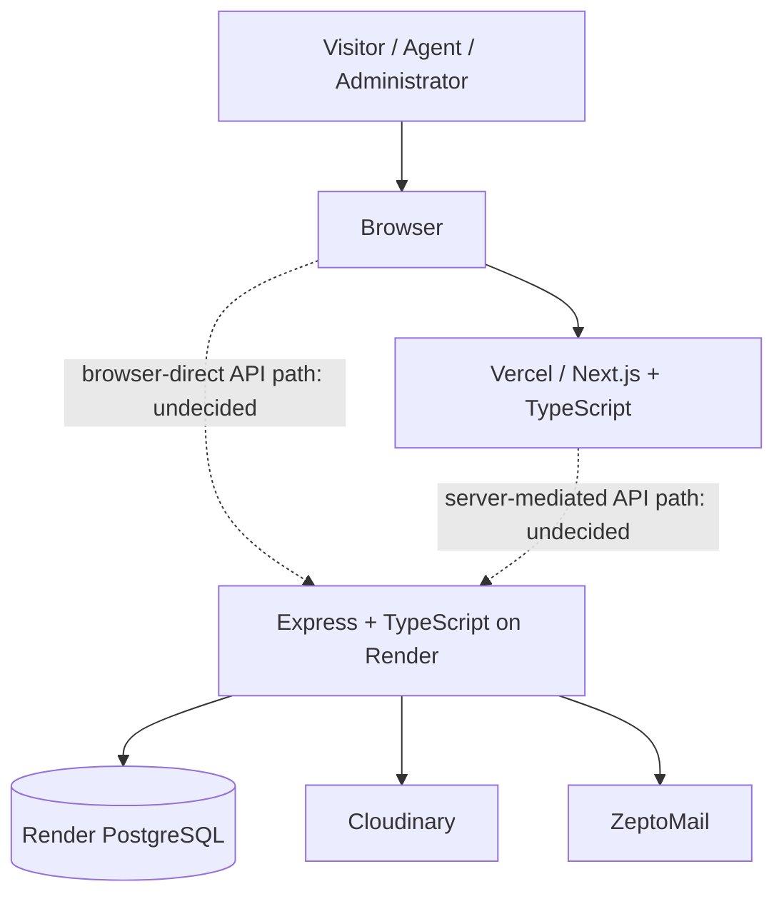

# Prime Haven Properties — Technical Architecture and Decision Register

**Document type:** Architecture baseline and architecture decision record  
**Status:** Approved planning baseline; listed validations and open decisions remain unresolved  
**Project:** Fictional Nigerian real-estate listings platform  
**Requirements baseline:** FRS v1.2

The original FRS v1.0 PDF is historical and unchanged. The architecture below records the approved direction; it does not imply that deployment, provider plans, transport topology or security configuration have already been validated.

---

# 1. System Architecture

**Status:** Approved planning baseline with implementation-time validations  
**Architecture style:** Separate SSR frontend and API backend

## Architecture overview

The browser loads the Next.js application. The exact path for application requests to Express (browser-direct or Next.js server-mediated) remains an open decision; the dotted paths in the diagram are alternatives, not simultaneous approved flows. Protected business operations are enforced by Express. The browser must never connect directly to PostgreSQL or receive database credentials.

## 2. Responsibilities

### Next.js frontend
- Public pages, Agent Portal and Administration Portal.
- Server-side rendering for public SEO-sensitive pages.
- Route/layout composition, page metadata and social previews.
- Client-side interactions and form usability.
- Communicates with Express API over HTTPS.
- Does not own authoritative authorization or business rules.

### Express backend
- REST API and business logic.
- Authentication, sessions, role and ownership checks.
- Listing lifecycle and moderation workflow.
- Inquiry persistence and notification orchestration.
- Input validation, rate limiting and upload-signature generation.
- Audit logging and administrative operations.
- PostgreSQL access.

### PostgreSQL on Render
- Users, properties, revisions, images metadata, inquiries, notes, sessions, audit log and settings.
- Relational constraints, transactions, indexes and migrations.
- No property image binaries; images live in Cloudinary.

### Cloudinary
- Image storage, delivery and transformations.
- Signed short-lived uploads generated by backend.
- Verify asset metadata before associating assets with a property.

### ZeptoMail
- Transactional messages: invitations, password reset, inquiry notification and visitor confirmation.
- Inquiry persistence must not depend on successful email delivery.

## 3. Hosting and provider decisions

| Component | Direction | Status |
|---|---|---|
| Next.js | Next.js + TypeScript | Approved |
| Frontend hosting/runtime | Vercel | Approved; use native Next.js deployment integration |
| Next deployment adapter | None separately selected | vinext is not part of the approved architecture |
| API | Express + TypeScript | Selected direction |
| API hosting | Render | Approved |
| Database | PostgreSQL on Render | Approved |
| ORM / migrations | Prisma ORM + Prisma Migrate | Approved |
| Images | Cloudinary | FRS requirement |
| Email | ZeptoMail | FRS requirement |

The Render-hosted Express API will connect to the Render-hosted PostgreSQL database. Prefer the provider’s private/internal connection path when the services are in a compatible region. Confirm the database plan, region, connection limits, backup/restore capabilities and connection details before integration; do not assume a particular plan feature is available.

## 4. Vercel deployment approach

Vercel is the approved frontend host. Use the platform's native Next.js integration and standard Git-based deployment workflow; do not introduce vinext or a separate deployment adapter.

A bounded initial deployment validation is still required as PH-SETUP-001 — Next.js Setup and Vercel Deployment. It is a setup/deployment smoke test, not a framework compatibility investigation or full product implementation. Verify:
1. A minimal Next.js + TypeScript application installs and runs locally.
2. App Router and nested layouts work.
3. A dynamic `/properties/[slug]` route renders the expected page.
4. Server-side rendering and data fetching behave as intended.
5. Page metadata, canonical URLs and Open Graph/Twitter metadata are present in rendered output.
6. The project builds successfully and deploys to Vercel through the connected Git repository.
7. The deployed routes and metadata behave correctly.
8. Environment variables can be configured correctly, with secrets kept server-side and no secret values exposed in the browser bundle or rendered client output.
9. Record Vercel plan eligibility, applicable usage limits and constraints for the intended portfolio/demo use.

This validation does not prove the full authentication or frontend/API integration design. Validate cookie, CORS, CSRF and API communication separately before implementing production authentication.

Vercel plan eligibility, usage limits and current terms must be checked against the intended portfolio/demo use at deployment time. Do not assume a free plan is suitable for commercial use.

## 5. Domain and browser/API communication

Preferred domain arrangement, subject to domain availability and provider configuration:
- `www.<project-domain>` — Next.js frontend
- `api.<project-domain>` — Express API

Use HTTPS. Configure CORS with an explicit allowlist, not wildcard origins with credentials. Cookie domain, Secure, HttpOnly and SameSite settings must match the final deployment arrangement. Protect state-changing requests with CSRF controls, including origin validation and appropriate cookie policy. Do not assume that different subdomains are the same origin; they are different origins even when they may be same-site.

## 6. Authentication and session model

Approved: PostgreSQL-backed server-managed sessions.

- Generate cryptographically secure, unpredictable opaque session tokens.
- Store only a cryptographic hash of the token in PostgreSQL.
- Set the browser cookie as HttpOnly, Secure in HTTPS environments and an explicitly chosen SameSite mode.
- Enforce 12-hour inactivity expiry and seven-day absolute expiry.
- Revoke immediately on logout and agent deactivation.
- Revoke/rotate sessions on relevant security events, with exact policy defined during implementation.
- Never log raw tokens.
- Check session, role and record ownership in Express on every protected request.

JWT is not required for this architecture. The benefit of server-managed sessions is centralized revocation and straightforward enforcement of account deactivation.

## 7. Database access, migrations and connections

- Keep database connection strings in backend environment variables.
- Use the appropriate Render database connection URL for the deployment environment; prefer private/internal connectivity between services where supported.
- Configure Prisma Client connection behaviour for the selected Render PostgreSQL plan and connection limits; verify whether pooling is needed and supported for the chosen setup.
- Avoid creating a new database connection for every request.
- Define migration ownership and a repeatable migration command.
- Review every generated migration before applying it.
- Back up before major or destructive migrations.
- Prefer backward-compatible migrations where practical: add, deploy compatible code, migrate data, then remove obsolete structures in a later release.
- Use transactions for operations that must succeed or fail together.
- Use parameterized queries or safe ORM APIs.
- Use PostgreSQL constraints for data integrity in addition to application validation.

Prisma ORM is approved for database access, and Prisma Migrate is the approved schema migration tool. Review generated migrations before applying them and keep Prisma schema changes aligned with PostgreSQL constraints and indexes.

## 8. Search and performance

Search requirements include filters, all-selected-amenity matching, keyword search and stable pagination. Evaluate PostgreSQL full-text search and trigram support as appropriate. Index based on actual query plans and workload, not by blindly copying the original MongoDB-style index terminology.

Performance must be measured end-to-end:
- Vercel → Express latency.
- Express → Render PostgreSQL latency, including connection establishment and any provider-specific availability behaviour.
- API response time.
- SSR render and page delivery.
- Image delivery from Cloudinary.

Measure frontend-to-API latency from the deployed Vercel application. Account for Render service availability/cold starts, PostgreSQL and external-service latency. Check Vercel plan eligibility and usage limits against the intended workload.

## 9. Inquiry and email reliability

Persist the inquiry before attempting email delivery. Track notification delivery status and failures. Provide controlled retry capability. The initial implementation may use persisted delivery status and a retry action; a transactional outbox may be adopted if complexity and reliability needs justify it.

Do not let an email provider outage roll back a successfully persisted inquiry.

## 10. Backups and recovery

Demo baseline:
- Independent weekly database export while actively developing.
- Export before major migrations or destructive maintenance.
- Store independent backups outside the Render database service and restrict access.
- Never commit backups or credentials to source control.
- Document restore steps and test restoration before deployment acceptance.

Production recommendation:
- Automated daily backups or provider-supported point-in-time recovery.
- Defined retention.
- Documented RPO/RTO.
- Regular restore drills.

The exact Render PostgreSQL plan features, limits, backup options and restore procedures must be rechecked at implementation/deployment time.

## 11. Observability and security

- Structured server logs without personal data, passwords, tokens or unnecessary inquiry content.
- Health/readiness checks for the API and database dependency.
- Error handling that does not expose stack traces or secrets to users.
- Strict environment-variable management.
- Security headers, HTTPS and HSTS.
- Rate limits for sign-in, password reset, inquiries and upload signing.
- Input schemas reject unexpected fields.
- `$`/dot object-key rejection is additional structured-input validation only; SQL injection protection is parameterized queries and safe database access.
- Dependency versions pinned and checked for vulnerabilities.

## 12. Open technical decisions

The following transport-topology question must be resolved before authentication and cross-origin session work: **Will browser-side code call the Express API directly, or will relevant requests be mediated by the Next.js server (for example, through a server-side proxy/BFF)?** The current architecture describes Next.js-to-Express communication, while the risk register also identifies browser-to-API CORS transport. These descriptions do not yet establish one final request path. Do not implement cookie/CORS/CSRF settings until the request path, deployed origins and credential flow are explicitly agreed.

- Initial Vercel deployment validation result and selected plan/usage constraints.
- API request path (browser-direct versus Next.js server-mediated), final domain and cookie/CORS/CSRF configuration.
- Express Render service plan and region.
- Render PostgreSQL region, plan, connection URL/limits and backup capabilities.
- Prisma connection/pooling configuration for the selected deployment.
- Backup destination and retention implementation.
- Email retry implementation.
- Logging/monitoring service.
- Exact session rotation policy.

---

# 2. Architecture Decision Register

**Status:** Current planning decision register  
**Rule:** A proposal is not an approval. Material deviations from the FRS must be recorded here.

| ID | Topic | Decision / current position | Status | Rationale / notes |
|---|---|---|---|---|
| DEC-001 | Database | PostgreSQL | Approved | Relational data and constraints suit the domain. |
| DEC-002 | Data terminology | Use tables, rows, columns, foreign keys and indexes | Approved | Correct relational terminology. |
| DEC-003 | Structured input keys | Reject keys beginning `$` or containing `.` in structured request objects; do not reject ordinary text values for these characters | Approved | Additional defensive validation, not SQL injection protection. |
| DEC-004 | SQL injection protection | Parameterized queries and safe ORM/database access | Approved principle | Required independently of DEC-003. |
| DEC-005 | Frontend | Next.js + TypeScript | Approved | SSR, routing and SEO requirements; developer wants to learn Next.js. |
| DEC-006 | Frontend host | Vercel | Approved | User approved Vercel as the Next.js frontend host; use native Next.js deployment integration. |
| DEC-007 | Next.js adapter | No separate adapter; native Vercel integration | Not applicable | vinext/Cloudflare deployment path was abandoned before implementation; no vinext spike will be run. |
| DEC-008 | Backend | Express + TypeScript | Approved | Retains FRS backend requirement and separates business logic. |
| DEC-009 | API host | Render | Approved | Conventional Node.js hosting for Express; plan and region must be confirmed before deployment. |
| DEC-010 | Database provider | Render PostgreSQL | Approved | PostgreSQL database will be hosted on Render alongside the Express API where practical. Confirm plan, region, connection limits and backup capabilities. |
| DEC-012 | Images | Cloudinary | Retained from FRS | Signed uploads and image delivery. |
| DEC-013 | Email | ZeptoMail | Retained from FRS | Transactional email. |
| DEC-011 | ORM and migrations | Prisma ORM + Prisma Migrate | Approved | Prisma Client for application database access; Prisma Migrate for schema migrations. Review generated migrations before applying. |
| DEC-014 | Session architecture | PostgreSQL-backed server-managed sessions | Approved | Immediate revocation and clear idle/absolute expiry enforcement. |
| DEC-015 | Published listing edits | Stage edits as draft revision; keep current public version until approval | Approved change from FRS v1.0 | Prevent unreviewed changes from replacing public content. |
| DEC-016 | Viewing requests | Request is not a confirmed appointment; agent confirms with visitor | Approved clarification | Avoid implying automated booking. |
| DEC-017 | Inquiry email notifications | New inquiry emails owning agent and admin; visitor confirmation if email supplied; no routine status-change emails initially | Approved | Reliable, bounded notification scope. |
| DEC-018 | Inquiry persistence | Persist inquiry before email attempt; log failures and support retry | Approved | Email outage must not lose inquiries. |
| DEC-019 | Agent deactivation | Revoke sessions and automatically unpublish Published/Under Offer listings; preserve records | Approved change from FRS v1.0 | Prevent inactive agent listings remaining live. |
| DEC-020 | Inquiry retention | Anonymise personal data after 24 months; handle verified deletion requests separately | Approved clarification | Preserve non-identifying records where appropriate. |
| DEC-021 | Moderation v1 | Manual admin approval for every new listing | Approved | Appropriate for demo and demonstrates moderation/RBAC/audit. |
| DEC-022 | Production moderation preference | Automated validation plus risk-based human review | Future preference, not v1 scope | Better scaling for a normal production system. |
| DEC-023 | Admin review standard | Check completeness, policy, image suitability and suspicious/inconsistent information; not professional valuation | Approved clarification | Distinguishes platform moderation from valuation. |
| DEC-024 | Listing form | Structured form with required fields mandatory, optional fields available and conditional fields by property type | Approved direction | Improve data quality; backend validation remains authoritative. |
| DEC-025 | Backup policy | Independent weekly exports for demo and before major migrations; production should have stronger automated backup/PITR | Approved direction | Provider restore window alone is insufficient. |
| DEC-026 | Original FRS and consolidated baseline | Preserve the original v1.0 PDF unchanged; maintain the consolidated current requirements baseline as FRS v1.2, retaining the v1.1 planning clarifications and v1.2 hosting change history | Approved | Maintains historical source integrity and traceability. |

## Hosting decision change history

**DEC-006 update (2026-11-19):** Cloudflare Workers was replaced by Vercel at the user's direction. The vinext proposal and its compatibility spike were cancelled before implementation. The original proposal is retained here only as decision history; it is not an active requirement or task. The consolidated current requirements baseline is FRS v1.2, based on the original v1.0 source plus the approved v1.1 planning clarifications and v1.2 hosting change recorded in `01_REQUIREMENTS_BASELINE_FRS_v1.2.md`.

## Open decisions / validation gates

| ID | Topic | Required action | Owner / timing |
|---|---|---|---|
| OPEN-001 | Vercel deployment validation | Deploy a minimal Next.js application through Vercel's native Git integration and verify core routes/SSR/metadata | Before frontend foundation is accepted |
| OPEN-002 | Domain/cookies | Decide custom domain and exact cookie/CORS/CSRF settings | Architecture/deployment design |
| OPEN-003 | Render API | Confirm service plan, region and cold-start tolerance | Before deployment |
| OPEN-004 | Render PostgreSQL | Confirm database plan, region, connection URL/limits, backup capabilities and restore process | Before database integration |
| OPEN-005 | Prisma connectivity | Confirm Prisma Client connection/pooling configuration for the selected Render PostgreSQL deployment | Database integration |
| OPEN-006 | Backups | Select independent storage destination and implement restore drill | Before production acceptance |
| OPEN-007 | Email retries | Choose persisted delivery-status/retry design or transactional outbox | Backend design |
| OPEN-008 | Session lifecycle | Define rotation/revocation triggers beyond logout/deactivation | Authentication design |
| OPEN-009 | API request path | Decide browser-direct Express calls versus Next.js server-mediated calls; document origins, credentials and implications before CORS/cookie/CSRF implementation | Before authentication and transport implementation |

## Decision-change procedure

A decision changes only when the user approves the change. Record: decision ID, old decision, new decision, reason, alternatives considered, FRS impact, architecture impact, migration impact and date. Update affected requirements and traceability entries. Do not silently overwrite history.

---
